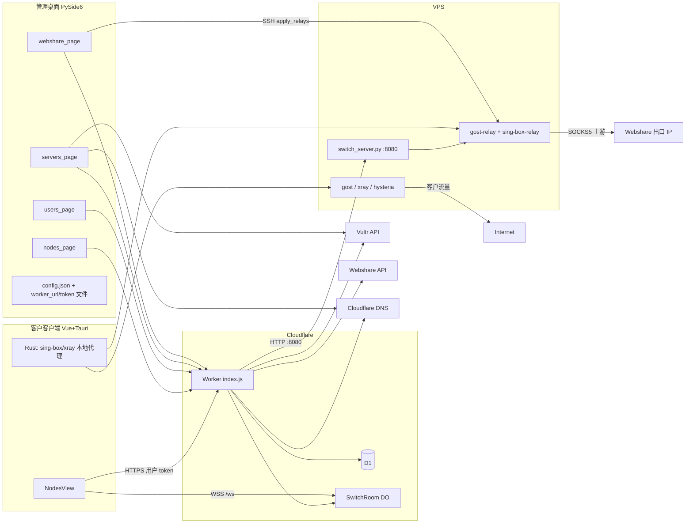

# vultr-proxy-switcher 架构分析

分析范围是当前仓库的实际代码。仓库里没有 `docs/` 下的需求文档（本文件除外）、没有 `tests/`、没有 `app/relay_ops.py`。下文的「需求对照」因此以 `README.md`、代码注释、以及主人描述的目标布局为准，不臆造一份不存在的规格书。

主人描述的体量与仓库现状有偏差，以实测为准：

| 文件 | 主人印象 | 实测 |
| --- | --- | --- |
| `app/ui/users_page.py` | 132KB | 65.2KB / 1494 行 |
| `app/ui/webshare_page.py` | 86KB | 71.0KB / 1596 行 |
| `app/ui/nodes_page.py` | 52KB | 47.9KB / 1073 行 |
| `app/ui/servers_page.py` | 127KB | 123.5KB / 2839 行（最大的 UI 文件） |
| `worker/src/index.js` | 90KB | 78.6KB / 1757 行 |
| `app/relay_ops.py`、`tests/test_relay_ops.py`、`docs/` 需求文档 | 已存在 | 不存在 |

另外还有主人描述里没点名、但已经是运行路径的部分：Tauri/Rust 壳、`worker/assets/` 里提交的前端构建产物、`scripts/switch_server.py`（部署到 VPS 上的控制面）、以及一批一次性修复脚本。

---

## 1. 总体架构

系统是四层，外加三家云 API。

1. **管理桌面（PySide6，`app/`）** 跑在主人 Mac 上。它买/删 Vultr 机器、拉 Webshare 代理列表、把 Webshare IP 包成中转、给客户分配节点、同步 Vultr 流量。本地状态在 `~/.vultr-proxy-switcher/config.json`。Worker 地址和管理员 token 不在这份 JSON 里，而在同目录的 `worker_url.txt` 和 `worker_admin_token.txt`。
2. **客户客户端（Vue 3 + Tauri 2）**。窗口直接加载线上 `https://user.yduas.cc/`（`tauri.conf.json` 的 `url` / `frontendDist`），前端热更新不靠重装安装包。本地代理、测速、系统代理走 Rust command，sidecar 是 sing-box 和 xray。
3. **Cloudflare Worker `vultr-proxy-users`** 是唯一的线上控制面：用户/分配/会话在 D1，切换进度用 Durable Object `SwitchRoom` 做 WebSocket，cron 每分钟收尾卡住的切换、拉中转流量、回收到期或用尽的 relay。
4. **VPS** 有两种角色，不要混：
   - **Vultr 出口节点**：cloud-init 装 gost（SOCKS5 + Shadowsocks）、xray（VLESS+Reality）、hysteria2。客户直连这台机器，出口就是这台机器的 IP。
   - **前置中转（relay）**：一台长期在线的 Vultr（或手工服务器）上，每个 relay 两个 systemd 服务：`gost-relay-<id>`（SS + SOCKS5 入站）和 `sing-box-relay-<id>`（Reality + Hysteria2 入站），上游是 Webshare SOCKS5。同机还跑 `scripts/switch_server.py`，监听 `0.0.0.0:8080`，提供 `/switch`、`/stop`、`/traffic`。

外部依赖：Vultr API v2（建机/销毁/带宽）、Webshare API v2（列表/替换 IP/流量）、Cloudflare DNS API（A 记录，TTL 60，不走橙云）、Let's Encrypt（acme.sh）、IPQualityScore（住宅/机房 IP 打分）。Worker 可以用 `CONTROL_URL` + `CONTROL_SECRET` 把 Vultr 调用转到一台控制机；Cloudflare DNS 在 Worker 里是直连 `api.cloudflare.com`。



### 1.1 用户分配

1. 用户页 `create_user` → `POST /admin/users`。密码在 Worker 里 PBKDF2-SHA256（10000 次、16 字节盐），存 `salt$hash`。
2. 服务器页或中转页打开 `assign_dialog`（定义在 `users_page.py` 末尾），组一份 `node_data` JSON，调用 `POST /admin/assignments`。
3. `resource_type` 只允许 `vultr` 或 `relay`。relay 有部分唯一索引 `idx_relay_exclusive`：一个 relay id 只能分给一个用户。vultr 实例可以分给多个用户，切换时只更新查到的第一行（见第 4 节）。
4. 客户 `POST /login` 拿 32 字节 token，写入 `sessions`（30 天）。`GET /me/nodes` 返回快照，删掉 `_creds`，并附上剩余切换次数、已用流量、是否到期、是否用尽。

### 1.2 节点切换

**Vultr（异步，分钟级）**

1. 客户 `POST /me/switch`，body `{resource_id, region?}`。管理端走 `POST /admin/switch`，可以额外带 `plan`、`domain`、`creds`。
2. Worker 读旧实例，同国家里换一个 region（客户指定的 region 必须在套餐 locations 里），用 `gost.js` 的 `buildGostUserData` 生成 cloud-init（`os_id` 写死 1743），先创建新实例，再抓旧实例出站字节，再删旧实例。删失败只打日志，不回滚，避免重试造成更多孤儿机。
3. 写入 `switch_requests`，状态 `pending` / stage `booting`。客户切换的 `assignment_id` 是真实行；管理端切换写 `assignment_id=0, user_id=0, actor_type='admin'`。
4. 新机 cloud-init 结束时请求 `GET /admin/node-ready?new_id=`，把 stage 改成 `installed`。这个接口没有认证。
5. 客户轮询 `GET /me/switch/status`（管理端轮询 `/admin/switch/status`）。处理函数拿到 IP 后立刻改 Cloudflare A 记录，然后要么等 `installed`，要么创建超过 5 分钟就放行。用 `status` 从 `pending` 抢到 `processing` 防止并发重复加切换次数。完成后改 `assignments.resource_id` 为新实例 id，并给该用户的 SwitchRoom 推一条 WebSocket。
6. 超过 10 分钟仍 pending/processing 的，由 cron `sweepPending` 再跑一遍同样的收尾。客户端自己的超时是约 6 分钟，超时后靠 cron 补。
7. 桌面端在刷新服务器列表时读 `GET /admin/switch-flow`，把 `server_domains` / `server_configs` / 备注 / 名称 / 到期从旧实例 id 迁到新实例 id。

**Relay（同步，秒级）**

1. 同一条 `POST /me/switch`。`node_data._creds.candidates` 不足 2 个直接 400。
2. Worker 对 `http://<server_ip>:8080/switch` 发 POST（头 `X-Api-Key`），body 是下一个候选上游。
3. VPS 上的 `switch_server.py` 改 `gost-relay-<id>.service` 的 `-F`，并改 `sing-box/relay-<id>.json` 的 outbound，然后两个服务都重启。入站密码和端口不变。
4. Worker 把 `active_idx`、当前 `upstream`、展示用 `ip` 写回 `node_data`，切换次数 +1，直接返回 `{status:"done", new_ip}`。不走 `switch_requests`。

### 1.3 流量同步

两条口径，不要加在一起理解错：

- **Vultr**：桌面 `compute_bandwidth` 大约每 5 分钟拉每台实例的出站字节，减去 `server_flow_reset[instance_id]` 基准，`POST /admin/sync-flow` 写入 `assignments.used_gb`。客户看到的已用 = 该 assignment 上所有 `status='done'` 的 `switch_requests.old_used_gb` 之和 + `used_gb`。注释写明不再用 `server_cumulative_used` 做累加，避免重复计算。
- **Relay**：cron `syncRelayTraffic` 按前置机分组请求 `GET /traffic`。VPS 用 iptables 链 `RELAY_TRAFFIC` 按四个端口记账（只计数，规则末尾 RETURN）。Worker 把原始计数存在 `_creds.traffic_raw`：第一次只记基线，之后记增量；计数变小（重启清零）则把当前值当增量。单位换成 GB 后加到 `used_gb`。

重置流量：`POST /admin/reset-flow` 把该 `resource_id` 的 `used_gb` 置 0。桌面同时把当前出站写入 `server_flow_reset`，否则 5 分钟内同步会把重置盖回去。它不清 `switch_requests.old_used_gb`，所以客户侧「历史 + 当前」不一定归零。

### 1.4 停用 / 回收决策

没有单独的决策模块，规则散落在三处，而且不一致：

| 条件 | 客户 UI | Worker `/me/switch` | cron |
| --- | --- | --- | --- |
| `users.status=disabled` | 登录失败 | `requireUser` 拒绝 | 无 |
| 到期 | 按钮显示「已到期」 | 用日期字符串和「今天」比 | relay 用「现在」的日期时间比 `client_expiry` |
| 流量用尽 | 按钮显示「流量用尽」 | **不检查** | relay：`quota_gb>0 且 used_gb>=quota` 则停服务并删分配 |
| 当日次数用完 | `switch_remaining<=0` 就禁用 | `count>=limit` 才拒绝 | 无 |

Relay 回收动作：`POST :8080/stop`（`systemctl disable --now` gost 和 sing-box 两个 unit）→ 写 `recycle_log` → `DELETE` 该 assignment。删分配后唯一索引释放，IP 可以再分。Vultr 用尽或到期不会自动关机或销毁，只影响客户端按钮；服务器页另有按 `server_expiry` 的本地自动销毁。

手工回收在中转页和用户页里再写了一遍 SSH `systemctl disable`，和 Worker 的 HTTP `/stop` 是两条路。

### 1.5 中转部署

1. Webshare 页勾选 IP，选入口域名。多个 IP 可以合成一条线路（一个 relay、N 个 `candidate_upstreams`）或 N 条独立线路。
2. 端口从 `relay_port_high_water` 单调递增，删除不复用。SS 端口、SOCKS5 = SS+10000、Reality = SS+8000、Hysteria2 = SS+12000。这三处偏移在 `app/relay.py` 和 `scripts/switch_server.py` 各写一份，必须保持一致。
3. 写入 `config.relays`，Cloudflare 把入口域名 A 记录指到前置机，然后 `scripts/apply_relays.py` SSH：清理多余 unit、签 `*.yduas.cc` 证书、下发 gost unit 和 sing-box JSON。
4. `apply_relays.py` **不会**安装 `switch_server.py`。控制接口要另外 scp 到 `/usr/local/bin/switch_server.py`，密钥放 `/etc/switch_api_key`。Worker 能否切 relay，取决于这一步有没有做。

### 1.6 跨账号替换

仓库里没有跨账号替换模块。`relay_ops.py` 和它的 TDD 测试都不在树里。现有最接近的三件事：

- **Webshare 同账号换 IP**：`webshare.replace_proxy` → `POST /proxy/replace/`，再轮询 replacement id。成功后只刷新代理列表，不改已经生成的 `relays[]` 上游，也不改 D1 里的 `node_data`。
- **Vultr 同 API key 换实例**：销毁重建，不是换账号。桌面和 Worker 都只用一把 Vultr key（桌面在 config，Worker 在 secret `VULTR_API_KEY`）。
- **实例 id 迁移**：`ServersPage._migrate_server_config` 和 `scripts/migrate_stale_config.py` 按 `switch_requests` 的 old→new 链，把本地 config 的 key 从旧 UUID 搬到新 UUID。这是切换后的配置修复，不是跨账号。

如果后续要做「换一把 Webshare/Vultr 账号再替换资源」，需要新模块，不能假设 `relay_ops` 已经存在。

---

## 2. 分模块

### 2.1 桌面 `app/`

| 模块 | 职责 | 关键入口 | 外部依赖 | 耦合 |
| --- | --- | --- | --- | --- |
| `main.py` | 入口，最大化窗口，退出时停本地代理 | `python -m app.main` | PySide6 | `MainWindow` |
| `config.py` | JSON 读写，带线程锁；`mutate` 才是锁内读改写 | `get/set_value/update/mutate` | 本机文件系统 | 几乎所有页面 |
| `api_client.py` | 管理端调 Worker | 见下表 | urllib，强制不走系统代理 | UI 与 Worker 的唯一正式客户端 |
| `vultr.py` | 区域表、cloud-init、实例 CRUD、账单和带宽 | `VultrAPI`、`build_gost_user_data`、`compute_bandwidth` | `api.vultr.com` | 与 `worker/src/gost.js`、`region.js` 重复 |
| `webshare.py` | 套餐、代理列表、替换、订阅流量 | `load_lists`、`replace_proxy` | Webshare；大陆网络走 Worker `/ws-proxy` | 密钥来自 config |
| `cloudflare.py` / `domain.py` | zone、A 记录、子域名计数、SSH 签证书、热更新远端配置 | `sync_domain`、`apply_server_config` | CF API、paramiko | 服务器页、Webshare 入口域名 |
| `relay.py` | 端口、unit、sing-box JSON、`relay_node_data` | 纯函数，适合以后抽测试 | 无网络 | 被 apply_relays、中转页、用户分配使用 |
| `gencreds.py` | 每台机器独立账号；Reality 密钥调用本机 `bin/xray x25519` | `generate_credentials` | 本地 xray 二进制 | `server_configs` |
| `share.py` | socks/ss/vless/hysteria2 分享链接 | 与 Worker `buildLinks` 必须一致，目前并不完全一致 | 无 | 分配快照里的 `links` |
| `localproxy.py` / `ssclient.py` / `proto_client.py` / `sysproxy.py` | 管理端自己用的本地转发：回环 SOCKS5，Reality/Hysteria 起子进程，改系统代理 | `ProxyController` | xray/hysteria 二进制 | 只服务服务器页，客户客户端不用它 |
| `check.py` / `e2e.py` | TCP/UDP/出口 IP/四协议探测 | 脚本和服务器页检测 | 本机网络 | |
| `ipqs.py` | IP 质量分，本地按北京时间计每日额度 | `check_ip` | IPQS HTTP API | Webshare 页和中转页 |
| `ui/main_window.py` | 五个导航：Vultr、Webshare、中转、用户、设置 | 110 行 | | 页面之间不共享状态对象，只共享 config 和 Worker |
| `ui/servers_page.py` | 实例表、购买、手工机、切换 IP、本机代理、分配、流量同步、到期销毁 | `ServersPage` 及 6 个对话框 | Vultr + Worker + CF + SSH | 最大文件，对话框没有拆出去 |
| `ui/webshare_page.py` | 机房/住宅表、替换 IP、生成 relay、IPQS | `WebsharePage._generate_relays` | Webshare + SSH 部署 | 直接写 `relays` |
| `ui/nodes_page.py` | 中转列表、分享、删除、回收、回归 | `NodesPage` | Worker recycle-log、SSH | 和用户页重复停服务逻辑 |
| `ui/users_page.py` | 用户 CRUD、分配弹窗、重置次数/流量、手工停 relay | `assign_dialog` | Worker | 分配契约集中在这里，但服务器页/中转页也组 `node_data` |
| `ui/settings_page.py` | Vultr key、Webshare key、本机端口、域名和 CF token | | | 不编辑 Worker secret |
| `ui/workers.py` | `CallWorker` / `ProgressWorker` 把阻塞调用丢到 QThread | | | 各页自己持有 worker 列表 |

`config.py` 文件头写「只存非敏感字段」，和 `DEFAULTS` 不符：API key、root 密码、Reality 私钥、代理密码都在这份 JSON 里。

**`config.json` 键（从 `DEFAULTS` 和实际 `config.get` 合并，运行时文件不在本仓库）**

Vultr 与本机代理：`vultr_api_key`、`label`、`regions`、`plans`、`proxy_user`、`proxy_pass`、`proxy_port`、`local_port`、`manual_servers`、`active_upstream_id`、`active_upstream_cache`、`active_proto`。

域名与证书：`domain_name`、`cf_token`、`zone_id`、`cf_account_id`（仅脚本读取，不在 DEFAULTS）、`server_domains`、`domain_counter`。

每机状态：`server_configs`、`server_expiry`、`server_notes`、`server_names`、`server_cumulative_used`、`server_flow_reset`、`server_order`、`stale_assign_since`。

协议默认值：`ss_password`、`ss_port`、`root_password`、`reality_uuid`、`reality_public_key`、`reality_private_key`、`reality_short_id`、`reality_sni`、`reality_port`、`hysteria_password`、`hysteria_port`、`hysteria_mport`。

中转：`relays`、`relay_port_high_water`、`relay_password_pool`、`recycled_relays`、`returned_ips`、`switch_api_key`、`nodes_order`、`nodes_col_widths`。

Webshare：`webshare_api_key`、`webshare_plans`、`webshare_subscription`、`webshare_notes`、`webshare_scores`、`webshare_dc_col_widths`、`webshare_res_col_widths`、`webshare_dc_order`、`webshare_res_order`。

其它：`ipqs_key`、`ipqs_daily_limit`、`ipqs_usage`、表格列宽和 `user_order`。

`relays[]` 元素字段：`id`、`server_id`、`name`、`host`、`port`、`user`、`password`、`relay_port`、`relay_password`、`ip_type`（`dc`/`res`）、`entry_domain`、Reality 四件套、`hysteria_password`、可选 `candidate_upstreams`、`active_upstream_idx`。

**`node_data` 快照（D1 `assignments.node_data`，客户可见字段 + 仅管理端的 `_creds`）**

客户协议：`host`、`domain`、`ip`、`name`、`location`、`region`、`ip_type`、`socks5`、`ss`、`reality`、`hysteria2`、`links`、`expiry`、`client_expiry`、`quota_gb`（展示以列 `assignments.quota_gb` 为准）、`last_check_at`、`last_check_status`。

`_creds`（`/me/nodes` 会删掉）：Vultr 是整份代理凭据；relay 是 `{relay_id, server_id, switch:{server_ip, port:8080, api_key}, upstream, candidates, active_idx, traffic_raw}`。注释指向一份仓库里不存在的 `relay-assignment-d1-model.md`。

### 2.2 Worker

`worker/src/index.js` 单文件路由，没有 router 库。`gost.js` 生成 cloud-init，`region.js` 是区域表，`switch-room.js` 是 DO。

环境变量 / secret（不在仓库里）：`ADMIN_TOKEN`、`VULTR_API_KEY`、`CF_TOKEN`、`CF_ZONE_ID`、`CERT_TOKEN`、`GLOBAL_CREDS`、`CONTROL_URL`、`CONTROL_SECRET`。D1 binding 名 `DB`。DO binding 名 `SWITCH_ROOM`。

**客户接口**（`Authorization: Bearer <session>`，登录除外）

| 方法 | 路径 | 作用 |
| --- | --- | --- |
| POST | `/login` | 发 token |
| GET | `/me/nodes` | 节点列表 |
| POST | `/me/switch` | Vultr 异步切换或 relay 同步切换 |
| GET | `/me/switch/status` | 推进 pending，返回 items |
| POST | `/me/account` | 改密码（不能改用户名） |
| POST | `/me/note` | 备注 |
| POST | `/me/name` | 写 `node_data.name` |
| POST | `/me/check` | 写检测结果 |
| POST | `/me/reorder` | `sort_order` |
| GET | `/ws?token=` | 升级到该用户的 SwitchRoom |

**公开接口**

| 方法 | 路径 | 作用 |
| --- | --- | --- |
| GET | `/`、`/app`、`/index.html`、`/main.js`、`/style.css` | 托管构建后的前端 |
| GET | `/version` | 客户端版本、下载镜像、说明 |
| GET | `/build-stamp` | 前端热更新戳 |
| POST | `/admin/cert-save` | `X-Cert-Token`，缓存证书 |
| GET | `/admin/node-ready?new_id=` | **无认证**，把 stage 标成 installed |

**管理接口**（`X-Admin-Token`，与 `ADMIN_TOKEN` 做定长比较）

`GET/POST /admin/users`，`GET/PUT/DELETE /admin/users/:id`，`GET /admin/stats`，`POST/DELETE /admin/assignments`，`POST /admin/switch`，`GET /admin/switch/status`，`GET /admin/all-assignments`，`POST /admin/sync-flow`，`POST /admin/reset-flow`，`GET /admin/switch-flow`，`GET /admin/resource-assignments`，`GET /admin/recycle-log`，以及 `GET /ws-proxy/*` 反代到 `https://proxy.webshare.io/api/v2`（调用方自己带 Webshare `Authorization`，Worker 不保存这把 key）。

**WebSocket 消息**：DO 只是把 Worker POST 的 JSON 原文广播。实际发出的负载是 `{resource_id, stage, status, new_ip?, note?}`，而且只在用户切换进入 done/failed 时发。中间阶段不推，客户端仍靠 15 秒轮询。管理端切换不调用 `notifySwitch`。客户端用点击时的旧 `resource_id` 对上 `old_id`。

**D1 表**

- `users`：`username` 唯一，`password_hash`，`status`，`expires_at`，`note`，以及迁移加上的 `switch_limit/count/date`。登录不再用用户级 `expires_at` 拒绝，到期改看每台 `client_expiry`。
- `assignments`：`(user_id, resource_type, resource_id)` 唯一；relay 另有部分唯一索引。列含 `node_data`、`switch_*`、`quota_gb`、`used_gb`、`note`、`sort_order`。
- `sessions`：token 主键，30 天。
- `certificates`：按域名缓存 fullchain 和私钥，过期不复用。
- `switch_requests`：异步切换。列从多次 ALTER 叠成：`actor_type`、`domain`、`old_used_gb`、`new_bandwidth`、`retry_count`、`stage`。
- `recycle_log`：relay 自动回收。

`schema.sql` 只覆盖 users/assignments/sessions/certificates 的一部分列，**没有** `switch_requests`、`recycle_log`，也没有 users 的 switch 列。`migrations/` 是手工 `wrangler d1 execute --file`，不是 wrangler 的有序迁移目录：`001` 和 `002` 各有两个文件。新库不能只跑 `schema.sql`。

`checkTcpAlive`、`checkNodeHealthy`、`createReplacement` 三个函数没有任何调用方。`retry_count` 只有死代码会加。客户端「不通再切两次」是再发一次完整的销毁重建，不是走这段重建逻辑。

### 2.3 客户客户端 `client/`

- `src/api/index.js`：`API` 写死 `https://user.yduas.cc`。
- `src/api/ws.js`：token 放 query，断线 5 秒重连。
- `stores/auth.js`：token 和 user 进 localStorage。
- `stores/nodes.js`：`/me/nodes`，60 秒静默刷新；到期取所有节点里最晚的一天。
- `stores/proxy.js`：本地 mixed 入站端口 7890（测速另起一段 20000 以上的随机端口）。组 sing-box 和 xray JSON。管理端本地端口默认 1080，两套本地代理互不相干。
- `NodesView.vue`（672 行）：切换、批量切、测速、拖拽排序、列宽、分享、二维码。这是客户侧核心，不是主人印象里的「唯一大文件」——管理端四个页面都比它大。
- `App.vue`：侧边栏唯一业务项文案是「Webshare-IP」，内部 id 却是 `vultr`，实际列表包含 vultr 和 relay。
- `src-tauri/src/main.rs`：TCP/UDP 探测、直连公共 DNS 解析（避开 fake-ip）、系统代理、起停 sing-box/xray、多端口测速、打开下载链接。
- `legacy-src/main.js`：Vue 重构前的单文件前端，逻辑仍留在树里，容易让人改错地方。
- 线上真正跑的 JS 是 `worker/assets/main.js`（140KB，已压缩）和 `style.css`。`vite build` 输出到 `client/dist`，`bump-stamp.mjs` 给 html 加 `?v=`。仓库里没有把 `dist` 拷进 `worker/assets` 的脚本，这一步是手工的。

### 2.4 VPS 控制脚本 `scripts/switch_server.py`

标准库 `ThreadingHTTPServer`，无第三方依赖。`/switch` 要求 gost 和 sing-box 都成功才算 ok。`/traffic` 先按当前 unit 补 iptables 规则再读计数。`/stop` 幂等。监听公网 8080，认证是头里的 key 和文件内容做普通字符串相等比较。

### 2.5 其它脚本

产品路径：`apply_relays.py`、`daily_check.py`（配置漂移、DNS、443）、`migrate_stale_config.py`、`test_localproxy.py`、`verify_protocols.py`、`e2e_assign_test.py`（会写 SQL 文件去插 D1，不是 pytest）。

一次性运维，硬编码了某台机器或某个标签：`fix_to_us.py`、`rebuild_siyan04.py`、`rebuild_yduas4980us01.py`、`recreate_with_ss.py`、`restore_siyan06.py`、`rotate_with_check.py`、`analyze_config_loss.py`。

软路由 / WiFi，和代理产品无导入关系：`fix_tailscale.sh`、`install_tailscale.sh`、`fix_yy_boot.sh`、`fix_yy_bridge.sh`、`setup_kk_wifi.sh`、`setup_kk_wifi_v2.sh`、`setup_kk_wifi_40.sh`、`setup_yy_wifi.sh`。

图标：`make_icon.py`、`make_nav_icons.py`。截图：`screenshot.py`。

---

## 3. 技术栈、命令、测试

**栈**

- 管理端：Python `>=3.11`，uv + hatchling，PySide6，requests，PySocks，paramiko，qrcode。可选 pytest、ruff、pyinstaller。PyPI 源写的是阿里云镜像。版本号 `app/__init__.py` 为 `0.1.0`。
- Worker：JavaScript，Wrangler，`compatibility_date` 2026-10-01，D1，Durable Object SQLite 类，cron `* * * * *`。
- 客户前端：Vue 3.4、Pinia 2、Vite 5、qrcode。包版本 `0.1.3`。
- 壳：Tauri 2、Rust stable。macOS arm64 和 Windows x64。sidecar：sing-box 1.14.2、Xray 版本在 CI 里写的是 v26.10.21；cloud-init 里的服务端 Xray 注释要求固定 v26.3.27（更高版本会拒绝 sing-box 客户端）。这是一个真实的版本策略分裂。
- VPS：Ubuntu（`os_id` 1743，注释说这是 22.04；同文件注释又说 24.04 是 2284，但代码仍用 1743）、gost 2.12.0、sing-box、hysteria、systemd、ufw、iptables。

**命令**

```bash
# 管理端
uv sync
uv run python -m app.main

# 客户前端开发（浏览器，没有 Rust 命令）
cd client && npm install && npm run dev    # 127.0.0.1:1424

# 客户桌面
cd client && npm run tauri:dev
cd client && npm run tauri:build           # CI 用 tauri-action，tag mac-v__VERSION__ / win-v__VERSION__

# 前端构建戳（产物在 client/dist，还要手工同步到 worker/assets 再部署）
cd client && npm run build

# Worker
# 在 worker/ 目录，secrets 需事先 wrangler secret put
npx wrangler deploy
npx wrangler d1 execute vultr-proxy-users --remote --file=schema.sql
# 增量变更是 migrations/*.sql，按注释逐个 --file 执行，不要假设文件名顺序可重放

# 中转下发（读本机 config.json）
uv run python scripts/apply_relays.py [server_id server_ip]

# 本地代理冒烟（README 里唯一写了的测试）
uv run python scripts/test_localproxy.py
```

CI 只有 `.github/workflows/build-macos.yml` 和 `build-windows.yml`：push 到 `main` 且改了 `client/**` 时打安装包并发布 release。没有 Worker 部署流水线，没有 Python 测试流水线。

**测试现状**

- `pyproject.toml` 声明了 pytest，仓库里没有 `test_*.py`，也没有 `pytest.ini`。
- `scripts/test_localproxy.py` 是可执行冒烟脚本，不进 pytest。
- `scripts/e2e_assign_test.py` 依赖开发者本机绝对路径和一份真实 config，会生成往 D1 插数据的 SQL。
- Worker、Vue、Rust 都没有测试。
- 主人提到的 `tests/test_relay_ops.py` 不存在，所以「中转纯函数已有 TDD」这个前提目前不成立。`app/relay.py` 的端口和 unit 生成是最适合先补测试的纯函数。

---

## 4. 需求对照、缺陷、风险、技术债

### 4.1 对照

README 仍停留在「本地 127.0.0.1:1080 + Vultr gost」的第一版，没有用户、Worker、中转、客户客户端。以代码自身的完成度为准：

**已经接通**

- Vultr 购买、手工机、关机/开机、删除、同国家换 IP、DNS、每机凭据、四协议 cloud-init。
- 管理端四页导航、用户 CRUD、分配/取消、relay 独占、分享链接和二维码。
- 客户登录、节点列表、备注、改名、排序、改密码、版本检查、前端热更新刷新。
- Vultr 异步切换 + WebSocket 终态 + 轮询 + cron 收尾。
- Relay 候选轮换、VPS `/switch` `/stop` `/traffic`、cron 流量增量、到期/用尽回收和回收日志。
- Webshare 列表（含 Worker 反代）、订阅流量、同账号替换 IP、合并成一条线路。
- 桌面把自己的流量同步进 D1；切换后按 old→new 链迁移本地 config。
- macOS/Windows 客户安装包流水线。

**做了一半**

- 流量配额：字段、同步、客户端禁用、relay cron 回收都有；Vultr 用尽不会停机；`/me/switch` 不看配额；重置不清历史 `old_used_gb`；管理端切换的 `old_used_gb` 挂在 `assignment_id=0` 上，客户查询按 assignment id 求和时加不进去。
- 切换次数：服务端按 `count>=limit` 拒绝，列表下发的 `switch_remaining` 是 `limit - 1 - count`。limit=5、count=0 时界面显示还剩 4，并在还允许再切一次时就把按钮禁用。
- 到期：`/me/nodes` 和 cron 用北京时间的日期时间；`/me/switch` 用日期和「今天」的字符串比较。同一天内是否算到期，三处答案不同。`client_expiry` 若带时分秒，和纯日期比大小会偏。
- 健康检查：cloud-init 回写、客户端测速、自动再切两次都有；Worker 里的端口探测和自动重建函数是死代码。stage 文案（creating/testing/retrying）在客户端有，服务端几乎只写 booting/installing/done/failed。
- 证书：Vultr 节点把证书存 D1 复用；中转 Hysteria2 用 acme.sh 签通配符，缓存在服务器上。两套流程。
- 区域表：`vultr.py`、`worker/src/region.js`、`client/src/utils/index.js` 三份。客户端 `REGION_NAMES` 仍有 `hnl`，Worker 注释说已删除。
- Reality SNI 默认值：`config.py` / `gencreds.py` 是 `www.cloudflare.com`，`vultr.py` 的 cloud-init 和 `gost.js` 默认 `www.microsoft.com`。
- 分享链接：Python `share.py` 的 SOCKS 用 `socks://`，Worker `buildLinks` 用 `socks5://`。注释写明部分客户端认不出 `socks5://` 里的认证。Worker 只在 `links` 为空时补，所以旧快照会一直缺或一直错。
- 文档和测试：功能在代码里，规格和回归都不在仓库里。
- `switch_server.py` 与 `apply_relays.py` 分离，部署中转不等于部署控制接口。

**没有**

- `docs/` 里的需求、架构、数据契约（`relay.py` 注释引用的模型文档也不在）。
- `relay_ops.py` 和任何 pytest。
- 多 Vultr 账号、多 Webshare 账号、跨账号替换。
- Worker/Python 的 CI。
- 把前端构建产物发布到 Worker 的自动化。
- Vultr 流量用尽后的服务端强制停用。
- 全仓库 `TODO`/`FIXME`/`HACK`：搜索不到。欠账写在注释和死代码里，不在标记里。

### 4.2 明显缺陷

1. `switch_remaining` 少算 1 次，客户端比服务端更早锁按钮。
2. 管理端切换不把 `old_used_gb` 记到真实 assignment 上，切换后的流量继承会丢这段。
3. `reset_flow` 只清 `used_gb`，客户仍把历史 `old_used_gb` 加回去。
4. `/me/switch` 不拒绝已用尽流量。配额对 Vultr 只是客户端提示；relay 最多延迟到下一分钟 cron。
5. 到期比较的粒度在切换、列表、回收三处不一致。
6. 一台 Vultr 分给多个用户时，切换只 `SELECT` 第一行 assignment 来改 `resource_id`，其他用户仍指向已删除的实例。
7. `GET /admin/node-ready` 无认证。知道或猜到 `new_id` 就能把安装等待提前结束。
8. `certSave` 用普通 `!==` 比 token，不是定时安全比较。
9. 死代码 `createReplacement` 使「卡死自动重建、最多 2 次」的注释成为假文档。客户端重试会再销毁再创建，放大孤儿实例（删除旧机失败时注释已经承认这个风险）。
10. cron 注释写「每 10 分钟」，`wrangler.toml` 是每分钟。
11. `schema.sql` 与线上迁移漂移，按 schema 建新库会缺表缺列。
12. Webshare「替换 IP」不更新 `relays[]` 和 D1，已分配客户的上游仍是旧 IP，直到有人重新生成或手工改。
13. `apply_relays.py` 和 `daily_check.py`、`e2e_assign_test.py` 把 `sys.path` 或工作方式绑在开发者本机绝对路径上，换机器不能直接跑。
14. 客户壳 CSP 是 `null`，窗口加载远程页面，且该源被写进 Tauri capability 的 `remote.urls`，可以调用本地起代理、改系统代理。Worker 前端一旦被改，等于远程代码能驱动本机代理。
15. 服务端 Xray 钉在 v26.3.27，客户 sidecar CI 下载的是更新的 Xray。注释说明新 Xray 会拒绝 sing-box。测速用 xray、日常代理用 sing-box，行为可能不一致。

### 4.3 风险

- 切换先创建后删除，删除失败就留下仍在计费的旧实例。没有对账任务把「Vultr 上有、config 和 D1 都没有」的实例列出来，只有 `daily_check.py` 的反向检查（config 指向已销毁 id）。
- `switch_server.py` 明文 HTTP、监听 `0.0.0.0`。API key 写在 D1 的 `_creds` 里，管理端 `listUsers` 会把整份 `node_data`（含 `_creds`）返回给持有管理员 token 的人。
- D1 里还有 Reality 私钥、证书私钥、Webshare 上游密码。这是设计如此（切换要重建 cloud-init），不是误提交，但备份和 `all-assignments` 的暴露面很大。
- CORS 是 `*`。token 在客户 localStorage，WebSocket token 在 URL 上。
- PBKDF2 只有 10000 次。
- `config.json` 整文件读改写。`mutate` 是安全的；`get` 然后 `set_value` 的路径（子域名计数就是两次独立 `set_value`）在并发点击时会丢更新。
- iptables 计数解析依赖 `iptables -L -v -x -n` 的列位置，规则格式一变，流量就是错的。停掉的 relay 不再出现在 unit 列表里，计数也停止。
- 软路由脚本和产品脚本放在同一个 `scripts/`，并行改产品时容易误跑。

### 4.4 技术债

- 四个巨型 UI 文件把网络、SSH、表格、对话框写在一起。`NodeShareDialog` 在服务器页和中转页各有一份。停 relay 的 SSH 命令在中转页、用户页、Webshare 页各写一遍。
- cloud-init、区域表、分享链接、端口偏移各有两份或三份实现。
- `worker/assets/main.js` 是生成物，和 `client/src` 会分叉；`legacy-src/` 增加第三份。
- 版本号三处：Python `0.1.0`，客户和 Worker `CLIENT_VERSION` `0.1.3`。
- 没有自动化测试，回归靠 `daily_check.py` 和手工脚本。
- README 会误导新人和新的编码代理。

### 4.5 硬编码密钥与口令（只报位置，不记录值）

这些值已经在 git 历史里，应视为已泄露并轮换，不要把值抄进工单或聊天：

- `app/ipqs.py` 模块级 `DEFAULT_KEY`。`ipqs_key()` 在 config 没有 `ipqs_key` 时使用它。
- `app/config.py` 的 `DEFAULTS`：`proxy_user` 与 `proxy_pass` 不是空字符串。
- `scripts/apply_relays.py` 里 `config.get("cf_account_id", ...)` 的默认参数是一个账号 id。
- `scripts/setup_kk_wifi.sh`、`scripts/setup_kk_wifi_v2.sh`、`scripts/setup_kk_wifi_40.sh`、`scripts/setup_yy_wifi.sh` 顶部 `PASSWD` 常量。
- 另外：`scripts/daily_check.py`、`scripts/e2e_assign_test.py` 写死了本机绝对路径；`e2e_assign_test.py` 还写死了某台服务器地址和测试用户 id。`worker/wrangler.toml` 有 D1 `database_id`（标识符，不是口令）。Worker 的真正密钥如果只放在 Wrangler secret 里，则不在仓库中，这次没有读到 secret 存储。

---

## 5. 并行工作流建议

### 5.1 用几个代理

**4 个编码代理同时改代码，再加 1 个只读契约负责人（协调者本人，不和别人改同一批文件）。**

不要上到 6 个以上。冲突不来自「页面文件名不同」，而来自同一份 JSON 契约被多处手写：`node_data`、`config.json` 的键、`relays[]`、端口偏移、区域表、分享链接、Worker 路由。每多一个代理，这些契约就会被再复制一次。

也不要先只开 2 个。四个大块的主文件几乎不相交：Worker、`servers_page.py`、Webshare+中转+用户、客户客户端。2 个代理会把本可以并行的 123KB 服务器页和 78KB Worker 串行化。

第 5 个「专门抽 `relay_ops.py` 并补测试」的代理不要和下面的 C 同时开工。抽取会改 `relay.py`、Webshare 页和用户页，和 C 的文件所有权重叠。顺序应是：契约负责人先写一页契约（可以就加在本文档后面），C 按契约改；或者等 C 这轮合并后再抽纯函数。

一次性脚本（`rebuild_*`、`fix_*`、`setup_*wifi`）不要分给功能代理。它们硬编码了具体实例和路由器，和产品改动没有稳定接口。冻结即可。

### 5.2 四个工作流

**A. 控制面（Worker + VPS 控制接口 + 管理端 HTTP 客户端）**

- 独占：`worker/**`（含 `worker/assets` 的发布权）、`scripts/switch_server.py`、`app/api_client.py`。
- 对外接口：第 2 节的路由表、D1 列、WebSocket 负载、`node-ready` / `cert-save`、`:8080` 的三个路径。
- 典型任务：修剩余次数、流量历史和重置、切换时更新全部相关 assignment、给 `/me/switch` 加上配额判断、统一到期比较、给 `node-ready` 加认证、删或接上死代码、把 `schema.sql` 补成可重建的全量、cron 注释与真实调度对齐。
- 不要改 PySide 页面和 Vue。

**B. Vultr 管理端**

- 独占：`app/ui/servers_page.py`、`app/vultr.py`、`app/domain.py`、`app/cloudflare.py`、`app/gencreds.py`、`app/localproxy.py`、`app/ssclient.py`、`app/proto_client.py`、`app/sysproxy.py`、`app/proxy_worker.py`、`app/ui/proxy_controller.py`、`app/check.py`、`app/e2e.py`、`app/ui/settings_page.py`、`app/ui/main_window.py`。
- 调用 A 的 `api_client`，不改函数签名；需要新接口时把路径和 body 写成说明交给 A。
- 典型任务：切换后的本机 config 迁移、带宽同步与重置基准、到期销毁、把 2800 行页面按对话框拆文件（只在本目录内拆）、cloud-init 与 Worker 的差异列表（改生成逻辑要和 A 一起，不能单方面改 `vultr.py` 而不改 `gost.js`）。
- `settings_page.py` 也含 Webshare key 输入框。C 不要改这个文件；Webshare key 的键名 `webshare_api_key` 已固定。

**C. Webshare、中转、用户分配**

- 独占：`app/ui/webshare_page.py`、`app/ui/nodes_page.py`、`app/ui/users_page.py`、`app/webshare.py`、`app/relay.py`、`app/share.py`、`app/ipqs.py`、`scripts/apply_relays.py`。
- 用户页和中转页都停 relay、都组 `node_data`，拆开必然会改同一段 SSH 和同一份快照。放在一个代理里。
- 调用 A 的分配/回收接口；调用 B 的域名函数时只使用已有的 `sync_domain` / `get_zone_id`。
- 典型任务：替换 IP 后更新 `relays[]` 和已分配快照、部署时顺便检查 `switch_server.py` 是否在、去掉重复的 SSH 停服务（改走 VPS `/stop` 或 A 的回收接口）、分享链接与 Worker `buildLinks` 对齐、IPQS 密钥改为只从 config 读取。
- 不要改 `servers_page.py`。服务器页分配 Vultr 时会调用 `users_page.assign_dialog`，这个函数的参数列表视为契约，改之前通知 B。

**D. 客户客户端**

- 独占：`client/**`（不含把产物写入 `worker/assets` 的动作；构建完成后把 `dist` 交给 A 部署）。
- 只消费 `/login`、`/me/*`、`/version`、`/build-stamp`、`/ws`。不调用 `/admin/*`。
- 典型任务：剩余次数和到期展示与服务端对齐、侧边栏文案、切换失败和超时后的状态、测速用的内核与服务端 Xray 版本策略、不要把新逻辑写进 `legacy-src/`。
- Rust command 名字在 `app-commands.toml` 里，改名要同时改 `stores/proxy.js`。这是 D 内部的契约。

### 5.3 必须单人拥有的横切契约

协调者合并前核对，编码代理不各自「顺手改一版」：

1. **`node_data` 形状**，尤其 `_creds.switch`、`candidates`、`client_expiry`、`links`。写入点在 C（relay）和 B（vultr 分配），读取点在 A 和 D。改字段要三方同一轮改完。
2. **Worker 路由、状态码、错误 JSON `{error}`**。只有 A 改 `index.js` 和 `api_client.py`。
3. **D1 表和迁移**。只有 A 加列。不要再提交第二个 `001_*.sql`。
4. **`config.json` 键名**。新键先加进 `config.py` 的 `DEFAULTS`，由该键的主写入代理改 `config.py` 里这一个键，避免 B 和 C 同时重排整个字典。
5. **端口偏移 10000/8000/12000** 和 relay id 规则。`relay.py` 与 `switch_server.py` 分属 C 和 A，改偏移必须同一个提交对。
6. **区域表**三份拷贝。改 Vultr region id 时 A（`region.js`）、B（`vultr.py`）、D（`utils/index.js`）一起改。
7. **分享链接语法**。`app/share.py`（C）和 `buildLinks`（A）保持一个实现的行为；短期允许复制，但 SOCKS scheme 这类差异要由协调者指定以 Python 为准还是以 Worker 为准。
8. **客户版本号**。`client/package.json`、`tauri.conf.json`、`worker/src/index.js` 的 `CLIENT_VERSION` 和安装包文件名。D 改版本，A 改 Worker 常量，同一次发布。
9. **前端发布物** `worker/assets/*`。D 构建，A 提交并 deploy。不要两个代理都改 `main.js`。
10. **认证头**：用户 `Authorization: Bearer`，管理端 `X-Admin-Token`，证书 `X-Cert-Token`，VPS `X-Api-Key`。新增头要改 CORS 的 `Access-Control-Allow-Headers`（A）。

按这个切分，日常功能（修切换、改中转部署、改客户按钮、改服务器表格）可以四路并行，冲突面主要是 `config.py` 的几行和 `assign_dialog` 的签名。流量、次数、到期这种跨 UI 和 Worker 的行为，先由 A 改接口，B/C/D 只改展示，不要四个人同时发明新的计费公式。
